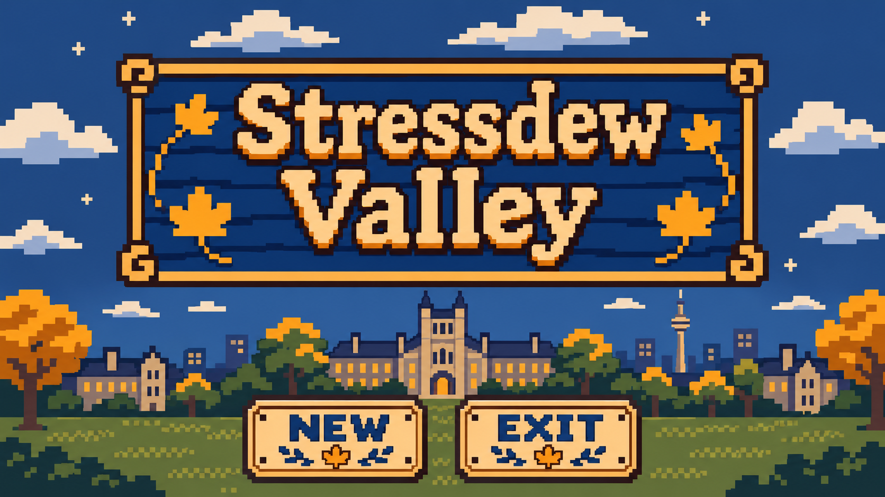

# Team Project

Please keep this up-to-date with information about your project throughout the term.

The readme should include information such as:
- a summary of what your application is all about
- a list of the user stories, along with who is responsible for each one
- information about the API(s) that your project uses
- screenshots or animations demonstrating current functionality

By keeping this README up-to-date,
your team will find it easier to prepare for the final presentation
at the end of the term.

# Stressdew Valley

> **PROPOSAL — scope reduction (draft for team review)**
>
> Our previous scope (academics, housing, food and work, NPCs, and email) was too large. This draft keeps two
> themes, **academics** (main focus) and **daily life and saving**, and splits them into **four user stories, one
> per member**, as the course requires ("one user story per team member"). The rubric gives ≤ 1/5 for scope if
> there are fewer user stories than members. A fifth story, the **St. George Street map (US5)**, is shared by
> everyone.
>
> - Removed: food and work (old US3), NPCs and email (old US4.1/4.2), and housing choice (old UC2.2, moved to
>   *Future Extensions*). The removed text is still in git history.
> - Each section has a **Note for the lead** box with suggestions. The lead of each section decides the final
>   wording. Please delete the note boxes once your section is done.
> - Only US4 has a lead so far. The leads for US1–US3 are **TBA**.
> - **Time budget:** We have about 2–3 weeks of part-time work, plus the map. Each story is split into
>   **MVP** (must work for the demo) and **Stretch** (only if time allows). With AI-assisted coding, writing code
>   is not the bottleneck. Understanding our own code for Q&A, and integrating five parts, are.

## Team Information
### Team Members
- Yuxiang Yuan
- Xinjia Shen
- Zhenbin An
- Lanxin Fu

---
## Project Description
### Domain
University life simulation, presented as a casual top-down game

**Stressdew Valley** is a casual simulation game about a term at university. The player chooses a major, attends classes, writes exams, and manages limited time and Energy from day to day, with real Toronto
weather.

**Why we are building it:** When students plan their next term, it is hard to imagine what a course load will
actually feel like until they are already living it. Stressdew Valley lets any student try out a term before
committing to it: choose their year of study and a set of courses, play through the term, and see how the
workload affects their daily Energy, their exam results, and their GPA. Along the way, the game shows that steady
class attendance pays off at exam time and that time and energy need to be planned. If a term does not go well,
the player can start over with a different plan. There is no real-world cost.

---
## User Stories
### US1 — Choose a Major
As a student player, I want to choose my major so that I can personalize my university experience and receive its predefined courses.

- **Building:** Registrar’s Office (Sidney Smith)
- **Responsible team member:** Lanxin Fu
- **MVP:** Choose one predefined major, view its attached courses, and confirm the selection. The system automatically assigns those courses.
- **Outside MVP:** Individual course selection, changing majors after confirmation, prerequisites, and timetable conflicts.

### US2 — Complete a Class Challenge
As a student player, I want to complete a class challenge for a course attached to my major so that I can earn preparation points before its exam.

- **Building:** Lecture Hall (Bahen Centre)
- **Responsible team member:** Xinjia Shen
- **MVP:** Complete one short challenge per assigned course, receive immediate feedback, spend energy, and earn preparation points.
- **Outside MVP:** Repeated challenges for additional rewards and scheduled classes.

### US3 — Take a Course Exam
As a student player, I want to take an exam for a course attached to my major and receive my result so that I can earn a course grade.

- **Building:** Exam Centre
- **Responsible team member:** Zhenbin An
- **MVP:** Complete one exam per assigned course, spend energy, and receive a recorded score and course grade. Preparation points can unlock one optional hint.
- **Outside MVP:** Exam dates, timers, retakes, and GPA calculation.

### US4 — Rest and Save Progress
As a student player, I want to end my study session by resting and saving my progress so that I can recover energy and continue later.

- **Building:** Innis Residence
- **Responsible team member:** Yuxiang Yuan
- **MVP:** Restore energy, save completed progress, and continue from the saved checkpoint when reopening the game.
- **Outside MVP:** Sleep schedules, day progression, and saving unfinished challenges or exams.

## US5 - Shared Campus Navigation

A small, clickable St. George Street connects the four buildings. Each member implements their building’s activity screen and its connection to the shared navigation.

Navigation does not consume energy. Residence remains accessible at zero energy.

Walking animation is a stretch goal. Opening hours, weather effects, and travel costs are outside the MVP.

---
## Use Cases

### UC1 — Choose a Major

**Supports:** US1  
**Location:** Registrar’s Office  
**Primary actor:** Student player

**Preconditions:**
- A game has started.
- The player has not confirmed a major.
- A predefined catalogue of majors and their attached courses is available.

**Trigger:** The player requests to choose a major.

**Success outcome:** The selected major and its attached courses are assigned to the player.

**Main success scenario:**
1. The system displays the available majors and their descriptions.
2. The player selects a major.
3. The system displays the courses attached to that major.
4. The player confirms the selection.
5. The system records the major and automatically assigns its courses.
6. The system displays the confirmed major and assigned courses.

**Extensions:**
- **4a — The player cancels:** No major or courses are assigned.
- **5a — The selected major is unavailable:** The system explains the problem and allows another selection without changing the player's academic plan.

**MVP boundary:** Courses are predefined by major and cannot be selected individually. Changing majors after confirmation is outside the MVP.

---

### UC2 — Complete a Class Challenge

**Supports:** US2  
**Location:** Lecture Hall  
**Primary actor:** Student player

**Preconditions:**
- The player has confirmed a major and received its attached courses.
- Class questions are available for the assigned courses.

**Trigger:** The player requests a class challenge.

**Success outcome:** The challenge is recorded as completed, preparation points are awarded, and energy is deducted once.

**Main success scenario:**
1. The system displays the player's assigned courses and class-challenge completion status.
2. The player selects a course.
3. The system checks that its challenge is unfinished and the player has sufficient energy.
4. The system explains the challenge and its energy cost.
5. The player confirms participation.
6. The system deducts energy and presents a short set of questions.
7. The player answers each question and receives immediate feedback.
8. The system records completion and awards preparation points based on correct answers.
9. The system displays the challenge result and updated energy.

**Extensions:**
- **3a — The challenge is already completed:** The system displays the previous result without deducting energy or awarding additional points.
- **3b — Insufficient energy:** The system suggests resting. The challenge does not start and no energy is deducted.
- **5a — The player cancels before starting:** Nothing changes.
- **6a — Questions cannot be loaded:** The system uses bundled fallback questions. If no suitable questions are available, it cancels the challenge and refunds the deducted energy.
- **7a — No answer is selected:** The system requests an answer without advancing.
- **7b — The player leaves early:** The system confirms cancellation. No completion or preparation points are recorded; spent energy is not refunded.

**MVP boundary:** One class challenge per assigned course. Preparation points do not directly change course grades.

---

### UC3 — Take a Course Exam

**Supports:** US3  
**Location:** Exam Centre  
**Primary actor:** Student player

**Preconditions:**
- The player has confirmed a major and received its attached courses.
- Exam questions and a grading rule are available for the assigned courses.

**Trigger:** The player requests to take a course exam.

**Success outcome:** The exam score and course grade are recorded, and the player sees the result.

**Main success scenario:**
1. The system displays the player's assigned courses and exam-completion status.
2. The player selects a course.
3. The system checks that its exam is unfinished and sufficient energy is available.
4. The system explains the exam length, energy cost, and whether preparation points have unlocked an optional hint.
5. The player confirms participation.
6. The system deducts energy and presents the exam questions.
7. The player answers the questions and submits the exam.
8. The system checks that all required answers are present.
9. The system evaluates the answers and determines the score and course grade.
10. The system records the result and displays the score, grade, and updated energy.

**Extensions:**
- **3a — The exam is already completed:** The system displays the existing result without starting another attempt or deducting energy.
- **3b — Insufficient energy:** The system suggests resting. The exam does not start and no energy is deducted.
- **5a — The player cancels before starting:** Nothing changes.
- **6a — Questions cannot be loaded:** The system uses bundled fallback questions. If none are available, it cancels the exam and refunds the deducted energy.
- **7a — The player requests an unlocked hint:** The system displays one hint for the selected question and marks the exam's hint as used.
- **7b — The player cancels the exam:** The system confirms cancellation. No grade is recorded; spent energy is not refunded.
- **8a — Required answers are missing:** The system identifies unanswered questions and allows completion before resubmission.

**MVP boundary:** One exam per assigned course. No immediate correctness feedback during the exam. Exam dates, timers, retakes, and GPA calculation are outside the MVP.

**Rule to finalize:** Agree on the preparation-point threshold that unlocks the hint and the score-to-grade conversion.

---

### UC4 — Rest and Save Progress

**Supports:** US4  
**Location:** Innis Residence  
**Primary actor:** Student player

**Preconditions:**
- A game is active.
- No class challenge or exam is in progress.

**Trigger:** The player requests to rest.

**Success outcome:** Energy is restored to its maximum and completed progress is saved as a checkpoint.

**Main success scenario:**
1. The player requests to rest.
2. The system explains that resting restores energy and saves completed progress.
3. The player confirms.
4. The system restores energy to its maximum.
5. The system saves the selected major, assigned courses, completed challenges, preparation points, exam results, and energy.
6. The system confirms that the checkpoint was saved.

**Extensions:**
- **3a — The player cancels:** Nothing changes.
- **4a — Energy is already full:** The system keeps energy at its maximum and continues to save the checkpoint.
- **5a — Saving fails:** Energy remains restored for the current session. The system reports that progress was not saved and offers a save retry.

**MVP boundary:** Rest is immediate. No sleep schedule, day progression, or real-time waiting. Residence is always accessible at zero energy.

---

### UC5 — Continue a Saved Game

**Supports:** US4  
**Location:** Title screen  
**Primary actor:** Student player

**Preconditions:**
- The application is running and the title screen is displayed.

**Trigger:** The player requests to continue a saved game.

**Success outcome:** The saved checkpoint is restored and the player resumes at Residence.

**Main success scenario:**
1. The player requests to continue.
2. The system finds the saved checkpoint.
3. The system checks that the checkpoint is valid.
4. The system restores the player's major, assigned courses, completed challenges, preparation points, exam results, and energy.
5. The system displays Residence with the restored progress.

**Extensions:**
- **2a — No checkpoint exists:** The system explains that no saved game is available and offers a new game.
- **3a — The checkpoint is damaged or unsupported:** The system explains that it cannot be loaded and leaves the saved file unchanged.

**MVP boundary:** Only completed progress saved at Residence is restored. Unfinished challenges and exams are not saved.

---

## Shared Campus Navigation

A small, clickable St. George Street connects the Registrar’s Office, Lecture Hall, Exam Centre, and Residence.

Selecting a building opens its activity screen. Players can return to the street; leaving an unfinished activity follows that activity's cancellation rules.

Navigation does not consume energy, and Residence remains accessible at zero energy. Walking animation is a stretch goal. Opening hours, weather effects, and travel costs are outside the MVP.

---
## Minimal Viable Product (MVP)
| Team Member | MVP Use Case |
|:-------------:|:--------------|
| Lanxin Fu | UC1 |
| Xinjia Shen | UC2 |
| Zhenbin An | UC3 |
| Yuxiang Yuan | UC4 |
| Shared | UC5 |

---
## Entities

### Player
Represents the student character, their energy, and their academic record.

### Major
Represents a predefined major and its attached courses. Selecting a major automatically assigns those courses to the player.

### Course
Represents a course attached to a major, including its description and question category.

### AcademicRecord
Represents the player's confirmed major, assigned courses, and academic progress.

### CourseProgress
Tracks class completion, preparation points, and the exam result for one assigned course.

### Question
Represents a multiple-choice question, its answer options, correct answer, explanation, and optional hint.

### QuestionSession
Represents an active class challenge or exam, tracking questions, submitted answers, completion status, and hint usage.

## Supporting Value Object

### ExamResult
Represents the recorded score and course grade from a completed exam.

---
## API Usage

**Planned US5 API:** [Open-Meteo](https://open-meteo.com/en/docs/historical-weather-api)

**How it will be used:** Suggestion only: real Toronto weather for each game day.

**Planned US2/US3 API:** [Hugging Face Datasets API](https://huggingface.co/docs/dataset-viewer/index) with the
[MMLU dataset](https://huggingface.co/datasets/cais/mmlu)

**How it will be used:** Suggestion only: university-level multiple-choice questions for classes and exams, with
each course mapped to an MMLU subject.

**API Name:**
**Documentation:** [Link]
**How it is used in the program:**

---
## Design Diagrams
### UML Class Diagram
### Sequence Diagrams

---
## Development Plan (proposal)
**Week 1:** Agree on the shared entities (`Course`, `Player`, `AcademicRecord`, `GameCalendar`) and the interfaces
between stories, such as the question source shared by US2 and US3. Build the main window and the clickable
St. George Street map. Each lead checks that their API can be called from Java. Set up Checkstyle.

**Week 2:** Each lead finishes their MVP use case (interactor, controller, presenter, view, and tests). Every PR is
reviewed by at least one other member.

**Week 3:** Integrate everything, and make sure saving covers every story's data. Do stretch goals if time allows.
Prepare slides and the demo; each member practises explaining the architecture of their own part.

**Working with AI coding tools:**
- The team designs entities and interfaces by hand; AI implements against them.
- Only change files in your own story. Changes to shared files (entities, main window) go in their own PR.
- A reviewer should be able to explain what a PR does before approving it.
- Write at least one test for each extension in your use case.

---
## How to Run
[Instructions for running the program.]

---
## Notes
[Any additional notes.]
