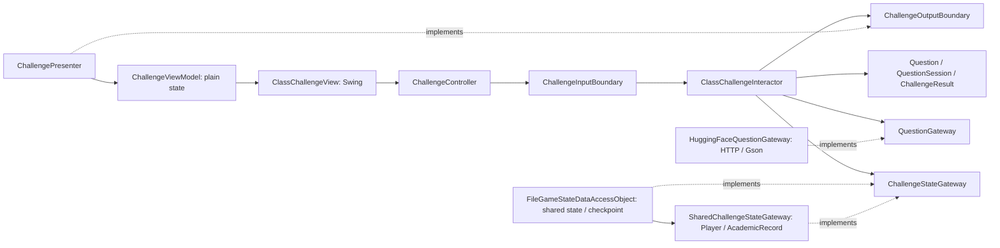

# UC2: class challenges and the shared question API

Xinjia Shen owns this module. The latest README and the current course/API requirements take priority
over PLAN.md. The old Mathematics and offline-question-bank plan is not implemented.

## What works

- Read assigned courses and completion status through an injected state interface.
- Preview the three-question challenge and its 20-energy cost before starting.
- Load and validate API questions before charging. API failures throw and spend nothing.
- Show immediate correctness feedback and the correct answer after each submission.
- Commit one preparation point per correct answer only after finishing all three questions.
- View a completed course result without another charge or reward.
- Cancel freely before starting. Confirmed early exit keeps the energy cost and records no completion or points.
- Reject empty answers, duplicate starts, repeated submissions, stale question clicks, and old attempt IDs.
- Keep final feedback and allow Finish to retry if the shared state cannot commit completion.
- Run API work off the Swing event dispatch thread, disable controls while busy, and update controls on the EDT.

Three questions, 20 energy, and one point per correct answer are the non-conflicting defaults retained from
the secondary plan. They are defined in `ClassChallengeInteractor` and `ChallengeResult`.

## Clean Architecture



The entity and use-case packages import no Swing, HTTP or JSON libraries. The interactor does not know the
actual Player, Course, AcademicRecord, save file, or scraper implementation. `ChallengeCourse` and
`ChallengeOverview` are immutable projections, not replacement academic entities or a second Player.

The view calls its controller from a `SwingWorker`. The presenter converts output into plain view state;
the view dispatches rendering to the EDT. `ClassChallengeFactory` creates and connects the objects.

```mermaid
sequenceDiagram
    actor Player
    participant UI as Swing / Controller
    participant UC as ClassChallengeInteractor
    participant HF as QuestionGateway
    participant State as Shared state adapter
    Player->>UI: Confirm selected course
    UI->>UC: START(courseId), on worker
    UC->>State: Read current assigned course and energy
    UC->>HF: Load three practice questions
    alt API or data failure
        HF-->>UC: Throw QuestionLoadException
        UC-->>UI: Controller presents error; confirmation stays available
    else Questions valid
        UC->>State: Atomically revalidate, lock activity and spend 20 energy
        UC-->>UI: Question without the correct answer
        loop Three questions
            Player->>UI: Submit selected answer
            UI->>UC: ANSWER(attemptId, questionIndex, answerIndex)
            UC-->>UI: Correctness and source answer
            Player->>UI: Next / Finish
        end
        UC->>State: Atomically commit result and points; release lock
        UC-->>UI: Result and energy
    end
```

## Integrated shared state and checkpoint

Coordination issues: [energy and state #9](https://github.com/yuanyx233/team-project/issues/9),
[academic data #10](https://github.com/yuanyx233/team-project/issues/10), and
[question API/navigation #11](https://github.com/yuanyx233/team-project/issues/11).
UC1, UC2, UC3, Rest and Continue now use the same `FileGameStateDataAccessObject` in `Main`.
The DAO implements `ChallengeStateGateway` and delegates its UC2 operations to
`SharedChallengeStateGateway`, using the actual current Player and AcademicRecord. UC2 no longer has
a separate implementation of its transactions inside the DAO.

The inspected baseline is main `d856a50`, including shared state (#20), UC1 (#21), academic saving (#22),
the UC2 adapter (#23), and integrated course/exam/checkpoint support (#24).
The battle permits up to five answers, so EXAM question requests now
support up to five questions. This does not change the three-question UC2 challenge or UC3's battle rules.

| Shared API | UC2 connection |
|---|---|
| `Player.spendEnergy/startActivity/finishActivity` | One charge per attempt; the same Player lock blocks exams, Rest, Continue and saves |
| `Course.getId/getName/getQuestionCategory` | #24 supplies the six README course names; the explicit ID-to-topic map is shared with exams |
| `AcademicRecord.getSelectedMajor/getCourseProgress` | Read dynamically through the existing `AcademicRecordAccess` port after Continue |
| `CourseProgress.getChallengeResult/getPreparationPoints/recordChallengeResult` | Stores completed class work; exam skills read its derived points without consuming them |
| `FileGameStateDataAccessObject` | Version-2 checkpoints restore class and exam results, plus the major, day, energy and weather |
| `Main.createView` / `Main.showGame` and `GameView` | The real Lecture Hall page receives the same DAO as the other buildings |

The shared catalogue uses CS101/CS201, BIO101/BIO201 and HIST101/HIST201 with the six README course names.
The DAO supplies its explicit `Map<String, QuestionTopic>` to the adapter and uses that same map for exams.
Missing entries throw before spending energy or changing progress. IDs and names are not guessed from
the broad MMLU subject in `Course.getQuestionCategory()`.

The adapter implements:

```java
ChallengeOverview loadOverview() throws ChallengeStateException;
ChallengeOverview startChallenge(String courseId, String attemptId, int energyCost)
        throws ChallengeStateException;
ChallengeOverview completeChallenge(String courseId, String attemptId, ChallengeResult result)
        throws ChallengeStateException;
ChallengeOverview abandonChallenge(String attemptId) throws ChallengeStateException;
```

- Start must atomically recheck enrolment, unfinished status, energy, and the shared activity lock, then
  charge exactly once. A failed check changes nothing. The check occurs after loading API questions because
  the state may have changed while waiting for the network.
- Complete must record this course's completion/points once and release the lock without touching exam grades.
  Replaying the same attempt ID must not add points again. A failure must leave state unchanged.
- Abandon releases only the matching lock, without a refund or rewards; replaying it must be harmless.
- State mutations return a consistent new overview. The adapter must use the current Player/AcademicRecord
  dynamically after Continue, not cache a replaced object.
- The shared DAO serializes UC2 actions against checkpoint loading/saving, exams and the Rest reservation.
  Rest holds the same Player lock while weather loads. Checkpoints contain completed results, not active
  attempts or unfinished QuestionSessions.

`CourseProgress.recordChallengeResult(result)` records one immutable result and rejects overwriting it.
`getPreparationPoints()` derives points from that result, so a separate mutable points total is unnecessary.
The adapter handles duplicate attempt IDs; these session-only records are not checkpoint data. Old attempts
are rejected if the current Player or AcademicRecord has been replaced.

Version-2 checkpoints store `correct` and `total` under each course's `challenge` entry. The existing loader
validates the three-question result and calls `recordChallengeResult` before replacing shared state.
Version-1 and version-2 checkpoints without completed class work remain readable. This change keeps the
checkpoint format introduced by the teammates; it does not add a second save file or schema.

The application creates the page on the EDT with the **same shared state** as the other buildings:

```java
ClassChallengeView lecture = ClassChallengeFactory.create(
        gameState, questions, () -> navigation.setActiveView("street"));
GameView game = new GameView(title, residence, navigation, registrar, lecture, exam);
```

`gameState` is the shared DAO. Internally, its UC2 adapter receives `this::getPlayer`, the existing
`AcademicRecordAccess`, and the shared course-topic map. The suppliers are evaluated on every action,
including after Continue replaces the objects. The six-argument GameView constructor receives the real
Registrar, Lecture Hall and Exam Centre pages from `Main.showGame`. Compatibility constructors retain
placeholders for callers that do not supply all activity pages.

The page refreshes when shown; `refresh()` can also
be called explicitly after a state replacement. Use `requestLeave()` when navigating away or closing a
window, so an unfinished challenge goes through confirmation. It invokes the supplied navigation callback
only after the state adapter successfully releases the activity.

No production fake player, hard-coded enrolment, duplicate academic entities, scraper, exam rules, or save
schema have been added. `FakeChallengeState` and the preview exist only under `src/test/java`.

## Shared question API for UC3

```java
QuestionGateway gateway = new HuggingFaceQuestionGateway();
List<Question> exam = gateway.getQuestions(
        QuestionTopic.SOFTWARE_DESIGN, QuestionPurpose.EXAM, 5);
```

The gateway returns exactly the requested number of distinct questions, or throws `QuestionLoadException`.
The selection supports one to three PRACTICE questions and one to five EXAM questions per course.
Existing three-question exam requests retain the same questions and ordering. UC3 owns answer hiding,
hint eligibility, energy policy, grading and final exam persistence.

`QuestionSession` supports editing exam answers, checking completeness, counting correct answers and using
one hint. `useHint(index)` returns the index of one wrong option to hide; it does not award points or change
answers. UC2 never uses the exam hint. Correct answers are absent from classroom output until feedback.

`ExamBattle` can finish after three, four or five submitted answers. UC3 now uses that battle condition
and grades correct answers divided by actual submitted answers, as specified in the latest README.
It does not use `QuestionSession.isComplete()` to wait for unused questions. One preparation point unlocks
Hint and two unlock Shield; each is usable once per battle without spending preparation points.
UC2 still awards points only after its full three-question challenge is completed.

## Six courses and introductory selection

| Course ID | Course / QuestionTopic | MMLU subject | Practice row IDs | Exam row IDs |
|---|---|---|---|---|
| CS101 | Programming Foundation / PROGRAMMING_FOUNDATION | high_school_computer_science | 1, 21, 29 | 59, 60, 72, 65, 83 |
| CS201 | Software Design / SOFTWARE_DESIGN | high_school_computer_science | 4, 20, 34 | 57, 63, 93, 69, 71 |
| BIO101 | Cell Biology / CELL_BIOLOGY | high_school_biology | 5, 18, 19 | 62, 67, 97, 84, 99 |
| BIO201 | Ecology / ECOLOGY | high_school_biology | 8, 21, 26 | 64, 82, 91, 79, 88 |
| HIST101 | World History / WORLD_HISTORY | high_school_world_history | 15, 23, 49 | 53, 57, 89, 62, 68 |
| HIST201 | Historical Perspective / HISTORICAL_PERSPECTIVE | high_school_world_history | 5, 38, 41 | 59, 64, 65, 79, 97 |

The provider is a dataset API, not a question-generation service. It has **no difficulty setting**. These
remote selections favour elementary operations, specifications/testing/documentation, cell structures,
ecosystems, world events and source interpretation. History still includes reading passages; there is no
claim of a measured easy difficulty or exact coverage of a UofT syllabus. Data quality and answer keys remain
provider limitations; the source answer is displayed rather than inventing an explanation.

Practice fetches rows 0–49; exams fetch 50–99. Only row references are stored in production, never question
text or answers. Every call fetches the remote page again; those references provide no offline behaviour.
The two purposes have disjoint question IDs per course. A cancelled retry uses the same practice selection
and costs energy again, but there is still at most one completed/rewarded challenge per course.

Example endpoint:

```text
https://datasets-server.huggingface.co/rows?dataset=cais%2Fmmlu&config=high_school_biology&split=test&offset=0&length=50
```

Transport and request timeouts are five seconds. Non-200 HTTP status, network failure, incomplete response,
missing selected rows, truncated cells, incorrect subject, invalid choices, and invalid answer indexes all
fail explicitly. Thread interruption is preserved. There is no fallback or disk cache. Test JSON fixtures
are synthetic and never included in the production classpath.

## Run and verify

Normal checks (no live service required):

```sh
mvn test
```

The UI tests exercise selection, confirmation, duplicate-start protection, background loading, empty-answer
feedback, all three submissions, completion, navigation after success, and API error/retry presentation.
Interactor tests also cover enrolment, completed-result viewing, exact/insufficient energy, early exit,
stale requests, concurrency, and failed completion retry. HTTP tests use a local test server or injected
responses. `SharedChallengeStateGatewayTest` also exercises the actual Player, AcademicRecord and
CourseProgress: one-time charging/rewards, early exit, changed state, API failures, and the real
Rest/Continue interactors respecting the challenge lock. `ClassChallengeIntegrationTest` uses the actual
shared DAO and UC2/UC3/Rest/Continue interactors to check classroom points, exam skills, checkpoint recovery,
saved-result viewing without another question load, all six course mappings and duplicate-request failures.

Live API check on macOS/Linux, after building:

```sh
mvn test-compile
java -cp "target/classes:$HOME/.m2/repository/com/google/code/gson/gson/2.11.0/gson-2.11.0.jar" app.QuestionApiCheck
```

Verified on 2026-11-23 with Java 17 compiling with `--release 11`: all 12 course/purpose requests returned
the requested three practice or five exam questions (48 total). An initial service HTTP 502 propagated
as an error; a separate manual rerun passed all requests. The check has no automatic fallback or API key.

To preview the Swing page with test state and real questions:

```sh
java -cp "target/test-classes:target/classes:$HOME/.m2/repository/com/google/code/gson/gson/2.11.0/gson-2.11.0.jar" view.ClassChallengePreview cs
```

Replace `cs` with `biology` or `history`. IntelliJ can also run this test-source main class directly.
This preview cannot verify real UC1 enrolment, shared energy, Rest/Continue locking or checkpoint restoration;
those need the shared adapter. The shared app's current lecture placeholder is intentionally unchanged.

Optional UI images for review:

```sh
mvn test -Duc2.render.dir=/tmp/uc2-ui-review
```

The initial UC2 implementation was merged into `yuanyx233/team-project` main through PR #13. Further
changes should be reviewed by two teammates before merging, as required by TeamContract.md.
